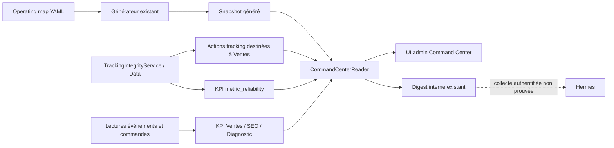
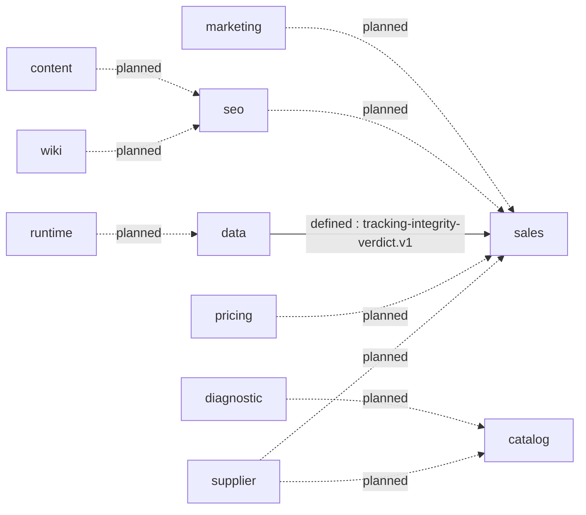
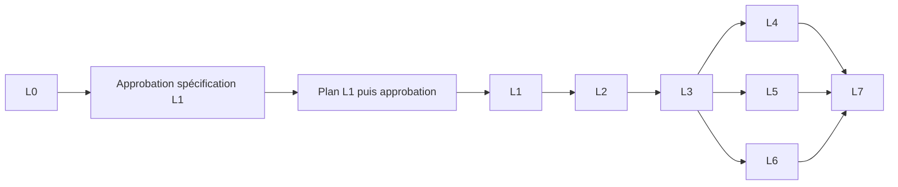

# AutoMecanik — Tableau de pilotage (24 départements)

> **Relecture L0 du 2026-10-10 :** voir [le cadrage vérifié](#l0-du-2026-10-10--cadrage-command-center) et la [spécification L1 proposée](./command-center-l1-spec-2026-10-10.md). Les mesures économiques et recettes antérieures ci-dessous restent historiques. Le code courant comporte quatre producteurs KPI et un handoff Data → Ventes défini : les anciennes mentions d'absence de producteurs ou de dix handoffs tous `planned` ne décrivent plus cette base. Aucun état servi ou activé n'est déduit de cette relecture.

> Doc d'analyse/pilotage (pas un registre, pas du canon). Pointe vers l'existant — ne
> duplique pas `canonical.json`. Maj : 2026-06-02 ; corrections de cohérence 2026-10-04 (bilan, ligne 12 / Vue 6 / fiche Achats sur l'état réel de `supplier-truth`, fiche Catalogue alignée sur la ligne 10, [réconciliation 24 ↔ 20](#réconciliation-24-départements--20-slugs-yaml), [état opérationnel](#état-opérationnel-au-2026-10-04-recette-départementale)). Voir le tunnel : [sales-funnel-scorecard.md](./sales-funnel-scorecard.md) (sous-funnel `/pieces`) + le funnel site GA4/GSC : [data-top-of-funnel-report.md](./data-top-of-funnel-report.md).
> **Règle d'or : existant d'abord → mesurer → améliorer → créer seulement si le scoring prouve le manque → pause sinon.**

> **Ce document ne crée aucun agent, aucun registre, aucun module et aucune infrastructure de reporting.
> Il route les capacités existantes vers les départements, clarifie leur mode de maturité, et définit le
> rapport attendu pour permettre le pilotage par scoring.**

> **Projection machine-readable (warn-only, PR #787).** Introduite pour un sous-ensemble *commerce-loop*
> (Achats & Fournisseurs → `supplier`, Commercial & Ventes → `sales`, Pricing → `pricing`) + leurs handoffs
> métier (`supplier→sales` dispo, `pricing→sales` marge), elle porte aujourd'hui **20 slugs** pour ces 24 lignes
> (correspondance exhaustive : [réconciliation 24 ↔ 20](#réconciliation-24-départements--20-slugs-yaml)). Formalisée, en **slugs**, dans
> [`agent-operating-map.yaml`](../.spec/00-canon/ai-registry/agent-operating-map.yaml) (blocs `departments:` /
> `department_handoffs:`, ai-registry). Pont vers les domaines techniques D1-D16 via `repo_domains`.
> **Autorité par champ** : ce markdown reste la **SoT narrative** (Vue 1/5/6 + format rapport) ; le yaml est la
> **SoT machine** des champs structurés (`id`, `lead`, `repo_domains`, `state`, handoffs). Linker, pas recopier
> — ne pas dupliquer le contenu entre les deux (cf. règle d'or ci-dessus).

## Doctrine opérationnelle — 6 règles concrètes
1. **Toyota Gate** — stop sur défaut, corrige à la source. 8 gates : RAW→WIKI · WIKI→PAGE · PAGE→PUBLISH · FAFA→PUBLISH · DEMANDE→DEVIS · DEVIS→PAIEMENT · **PRODUIT→PANIER (dispo !)** · AGENT→OUTPUT.
2. **Amazon Owner** — chaque département possède **un résultat (KPI)**, pas une activité.
3. **Apple Trust** — chaque page porte : pièce · véhicule · compatibilité · doute · moyen de vérifier · délai · prix · action suivante.
4. **Google Measure** — aucune décision sans mesure/preuve.
5. **Netflix Accountability** — chaque agent/skill : périmètre · entrée · sortie · KPI · gate · owner · pause. Les agents **exécutent**, ne décident pas.
6. **Team Topologies Flow** — départements séparés, flux transversaux. Jamais fusionner : Marketing≠Brand · Catalogue≠Achats · Pricing≠Finance · Produit≠IT · Gouvernance≠IA.

---

## Vue 1 — Carte des 24 départements
*Mode : LIVE (vraiment utilisé) / WORKTREE (non mergé) / MANUAL (skill on-demand) / NO-CODE (hors-logiciel) / DORMANT-SUPPORT (existe, peu utilisé) · Score : Fort/Moyen/Faible/Critique · Décision : REUSE/IMPROVE/NO-CODE · Reporting = doc on-demand read-only (auto = parké). « Capacités » car certains sont modules/signaux/engines, pas des agents.*

| # | Département | KPI possédé | Agents / skills / capacités assignés | Mode | Reporting attendu | Score | Next evidence | Décision |
|---|---|---|---|---|---|---|---|---|
| 1 | Direction générale | priorité semaine claire | IA-CEO (Paperclip) | DORMANT | board digest hebdo | Moyen | 1 décision/sem tracée | REUSE |
| 2 | Gouvernance | limites respectées | governance-vault + `governance-vault-ops` | LIVE | vault audit | Fort | gates sans bypass | REUSE |
| 3 | Stratégie & Scoring | verdicts reuse/improve/create | `continuous-improvement-global` | LIVE | weekly improvement verdict | Fort | gap-score/département | REUSE |
| 4 | Marketing & Acquisition | demandes qualifiées | module `marketing` + 3 agents G1 | SUPPORT | acquisition report | Moyen | mesuré 06-01 : GA4 **10 475 sessions/30 j** ; **direct 75 %** avec bounce ~100 % (signal bot/qualité suspect à vérifier), organic 22 % ; levier = fiabiliser direct + routage home/blog→produit | REUSE |
| 5 | Brand & Communication | confiance / avis | brand-compliance-gate + `fafa-brand-safety-reviewer` | LIVE | brand compliance report | Moyen | avis & cohérence | REUSE |
| 6 | Contenu éditorial | contenu validé réutilisable | `blog`/`ai-content` + `content-audit` | LIVE | content coverage report | Moyen | contenu→page→ATC | REUSE |
| 7 | Production Pages & SEO | pages générant ATC | module `seo` + R-agents SEO + `seo-gamme-audit` | LIVE | page report | Faible/Moyen | pages vues sans ATC (452→18) | IMPROVE |
| 8 | Media & Fafa | demandes issues vidéo | Fafa factory + `fafa-*` skills | MANUAL | media performance report | Moyen/Fort | source_code→demande (0) | IMPROVE |
| 9 | Knowledge RAW & WIKI | fiches WIKI validées | `rag-*` + `wiki-proposal-writer` + `rag-check` | SUPPORT | wiki readiness report | Fort | readiness chain ADR-033 | IMPROVE |
| 10 | Catalogue & Compatibilité | erreurs compat ↓ + dispo affichée vs réelle | `catalog`/`vehicles` + `vehicle-ops` + catalog-integrity | LIVE | catalog integrity report | **Moyen** | mesuré 06-01 : **~11,7k pièces embrayage affichées vendables** (épicentre rupture). Quarantaine **reportée → APRÈS sentinelle dispo (cf #12)**, jamais hide aveugle | **IMPROVE** |
| 11 | Diagnostic & Assistance | demandes issues diagnostic | `diagnostic-engine` + `vehicle-ops` | LIVE | diagnostic report | Moyen | diag→produit (5/196) | REUSE |
| 12 | **Achats & Fournisseurs** | dispo réelle / remb. rupture | tarif `price-import`(LIVE) + `suppliers.service`+`___xtr_supplier`(LIVE) + connecteur `reconcile`(contrat) + module `supplier-truth` (fusionné, inerte par flag) + `pri_dispo`/`pri_marge_n` | LIVE + DORMANT | supplier availability report | **Critique** | **ORDRE = tarif→config tous fournisseurs→sentinelle dispo→quarantaine**. `supplier-truth` (connecteurs inoshop→DistriCash **spl_id 71** « DCA » — réconciliation 06-01, pas 26 — + CAL spl_id 19, truth-engine, sync = sentinelle). **Niveaux de preuve au 2026-10-04 (`main` 27da20f66)** : code présent **oui** · branché **oui** (`AppModule` : `GET api/admin/supplier-truth/status`, admin, lecture seule ; `WorkerModule` : runner + scheduler Bull 4 h + job processor) · activé **seulement si** `SUPPLIER_TRUTH_SYNC_ENABLED` vaut exactement `true` (DEV : absent ; `.env.example` : `false` ; PREPROD/PROD : non vérifié) · exécution observée **non vérifiable** (lecture base PROD non autorisée) · dispo fournisseur vérifiée **non**. Désactivation désormais totale : le flag à `false` désarme le repeatable persistant dans Redis et le job processor refuse tout job résiduel (recette #9, 2026-10-04). `OrderAvailabilityService` n'a **aucun** consommateur panier/commande et lit les tables de consensus H3 qu'aucune migration ne déclare. Chantier = activation owner-gated + H3 + câblage panier/commande, PAS construire. Quarantaine en dernier | IMPROVE |
| 13 | **Commercial & Ventes** | paiement **gardé** | `orders`/`cart` + funnel `__seo_event_log` | LIVE | sales funnel report | **Critique** | panier→checkout→payé | IMPROVE |
| 14 | Service Client & Fidélisation | relances / satisfaction | `support` + retention agent + abandoned-cart | DORMANT | retention report | Faible | 0 panier abandonné capturé | IMPROVE |
| 15 | Logistique & Opérations | délais / retours | `shipping`/`orders` (physique externe) | SUPPORT / NO-CODE | délais/retours report | Moyen | délai réel expédition | IMPROVE / NO-CODE |
| 16 | Pricing | marge nette protégée | `pricing` + `PricingInvariantsService` | LIVE | margin risk report | Fort | marge sur paniers réels | REUSE |
| 17 | Finance & Comptabilité | cash / paiements reçus | `invoices` + compta externe | NO-CODE | cash digest (manuel) | Support | cash net après annulations | NO-CODE |
| 18 | Juridique & Assurances | conformité | — | NO-CODE | — | Dormant | — | NO-CODE |
| 19 | Risk & Audit | risques suivis | `audit/` + ratchets CI + `runtime-truth-audit` | LIVE | risk/drift report | Moyen | risques ouverts/fermés | REUSE |
| 20 | Produit & Expérience Client | conversion / abandon | `frontend-design`/`responsive-audit`/`web-vitals-audit` + design-tokens | MANUAL | UX/CWV audit report | Faible/Moyen | mesuré 06-01 : **page NON coupable (98,6% vendables)** ; 96% non-ajout = **mix-trafic/intention** (gammes cheap browse = 0 panier) + **INP mobile 712ms (poor)** | IMPROVE |
| 21 | IT & Runtime | site fiable & mesuré | NestJS/Remix/Supabase + CTO + `runtime-truth-audit` | LIVE | runtime health report | Fort | segment panier→paiement aveugle | REUSE |
| 22 | **Data & Analytics** | tracking fiable (vérité) | RCOP (`seo-monitoring`) + `web-vitals-audit` | LIVE | tracking integrity report | Moyen | mesuré 06-01 : tracking site-wide **EXISTE déjà** (`__seo_ga4_daily` 10 488 l. + `__seo_gsc_daily` 47 899 l.) ; reste aveugle = **segment panier→paiement** + **attribution 0 %** (≠ « haut non mesuré ») | IMPROVE |
| 23 | IA, Agents & Automatisation | capacités utiles ≠ complexité | `canonical.json` + skills registry + `continuous-improvement-global` | LIVE | capability report | Moyen | agents non reliés/inutilisés | REUSE (PAUSE création) |
| 24 | People, Formation & Doc | système compréhensible | `.claude/knowledge` + REPO_MAP + `.claude/rules` | LIVE | doc coverage report | Faible | modules « rôle à rédiger » | REUSE |

**Types Team Topologies** — Stream : Marketing · Pages&SEO · Commercial · Service Client · Fafa · Produit · | Platform : IT · Data · IA/Agents · | Enabling : Gouvernance · Stratégie&Scoring · Risk&Audit · People/Doc · Brand · | Complicated-subsystem : Catalogue · Pricing · Diagnostic · Knowledge · Achats.

**Bilan : 12 REUSE (dont #23 « PAUSE création ») · 9 IMPROVE · 2 NO-CODE · 1 mixte IMPROVE / NO-CODE (#15) = 24**, chaque ligne comptée une seule fois (REUSE : 1-6, 11, 16, 19, 21, 23, 24 · IMPROVE : 7-10, 12-14, 20, 22 · NO-CODE : 17, 18). Rien à construire — voir le backlog parké dans le scorecard tunnel.

### Réconciliation 24 départements ↔ 20 slugs YAML

Les **24 lignes** ci-dessus sont la carte narrative ; `agent-operating-map.yaml` (`departments:`) porte **20 slugs**.
Correspondance exhaustive (aucun id inventé). Le numéro de ligne n'est **pas** un domaine technique : la ligne #16
« Pricing » n'a rien à voir avec le domaine D16 « Maintenance » de `domains.yaml`.

| # | Département (narratif) | Slug YAML | Écart |
|---|---|---|---|
| 1 | Direction générale | — | aucun slug |
| 2 | Gouvernance | `governance` | — |
| 3 | Stratégie & Scoring | `strategy` | — |
| 4 | Marketing & Acquisition | `marketing` | — |
| 5 | Brand & Communication | `brand` | — |
| 6 | Contenu éditorial | `content` | — |
| 7 | Production Pages & SEO | `seo` | — |
| 8 | Media & Fafa | `media` | — |
| 9 | Knowledge RAW & WIKI | `wiki` | — |
| 10 | Catalogue & Compatibilité | `catalog` | — |
| 11 | Diagnostic & Assistance | `diagnostic` | — |
| 12 | Achats & Fournisseurs | `supplier` | état/preuve YAML périmés (citent la branche `feat/supplier-truth-runtime-wiring` « not merged ») |
| 13 | Commercial & Ventes | `sales` | — |
| 14 | Service Client & Fidélisation | `support` | — |
| 15 | Logistique & Opérations | `logistics` | — |
| 16 | Pricing | `pricing` | — |
| 17 | Finance & Comptabilité | `finance` | libellé YAML « Finance & Facturation » |
| 18 | Juridique & Assurances | — | aucun slug |
| 19 | Risk & Audit | — | aucun slug |
| 20 | Produit & Expérience Client | — | aucun slug |
| 21 | IT & Runtime | `runtime` | libellé YAML « Runtime & Observability » |
| 22 | Data & Analytics | `data` | — |
| 23 | IA, Agents & Automatisation | `ia-agents` | — |
| 24 | People, Formation & Doc | `people` | **homonymie seule** : le slug est « People & Staff » (capacité `staff`, `repo_domains` D11+D13), alors que la ligne #24 désigne la doc et la connaissance (`.claude/knowledge`, REPO_MAP, `.claude/rules`). Le module `backend/src/modules/staff/` (gestion admin du personnel) est classé **D8** dans `canonical.json`. Périmètres disjoints. |

**20 slugs = 24 − 4 lignes sans slug (#1, #18, #19, #20)** ; aucun slug sans ligne. Conséquence : le Command
Center (`scripts/governance/build-command-center-snapshot.js` → `audit/registry/command-center-snapshot.json` →
`/admin/command-center`) affiche ces **20** slugs, pas les 4 autres. Le YAML n'est **pas** étendu ici. Il faudrait
créer 4 ids nouveaux et leur attribuer des `repo_domains` (le schéma en exige au moins un, et un `state` parmi
`live/partial/dormant/broken/duplicate`). Or Juridique est NO-CODE et Direction générale est hors repo : ce serait
inventer, dans `.spec/00-canon/**`, qui est owner-only. **Décision owner.** D'ici là, ces 4 lignes ne sont suivies
que dans ce document. Les écarts de la ligne 12 et de `people` relèvent du même fichier : correctif proposé à
l'owner, non appliqué ici.

### État opérationnel au 2026-10-04 (recette départementale)

**Base** : `main` f1c601170 + branche `worktree-departments-operational`, non fusionnée.

**Environnement** : DEV uniquement. Les tests tournent sous jest. Les destinations base, Redis, stockage objet et
recherche pointent vers `127.0.0.1:1`, une adresse injoignable. Aucune application n'a été démarrée, faute d'isolation
prouvée des destinations du `.env` DEV. Aucune transaction, publication, campagne ni écriture distante.

**Lecture des colonnes**

- **Owner déclaré** : le `lead` du YAML. C'est un **rôle**, aucune personne n'est nommée.
- **Résultat observé** : ce que la recette a constaté en DEV. Rien n'a été observé en PREPROD ou en PROD : la lecture
  de la base PROD n'est pas autorisée.
- **Certification** du Command Center : `CERTIFIED` est **structurel** (cartographie et preuves déclarées). Ce n'est
  pas une certification métier.
- **Suites marquées (r)** : rejouées sur la base f1c601170. Les autres ont tourné sur la base 27da20f66. Le delta
  27da20f66→f1c601170 ne touche pas leur code (images frontend, annulation de commande, migration SQL associée), et
  la partie commande a été rejouée.

**KPI** : aucun des 20 `kpi_primary` n'a de producteur. Le KPI de chaque ligne est donc **indisponible**, ce qui ne
veut pas dire zéro. Unité, fenêtre et fraîcheur sont sans objet tant qu'aucun producteur n'existe.

**Proxys existants, non promus KPI**

- Pricing : contrôle `VENTE_BELOW_ACHAT` à l'import.
- Wiki : `scripts/wiki/wiki-readiness-check.py`, non lancé dans cette recette.
- Ventes : la définition de « paiement gardé » existe dans [sales-funnel-scorecard.md](./sales-funnel-scorecard.md)
  (payée et non annulée), sans producteur automatique.

| # | Département | Périmètre validé | Mode | Env. | Owner déclaré | Résultat observé | Preuve | Difficulté restante | Prochaine action |
|---|---|---|---|---|---|---|---|---|---|
| 1 | Direction générale | aucun | DORMANT | hors dépôt | aucun (pas de slug) | non exercé | — | ni slug ni KPI | owner : slug ou suivi narratif seul |
| 2 | Gouvernance | validateur de la carte opérationnelle + auto-tests | LIVE | DEV | `governance-lead` | 0 erreur, 0 avertissement ; auto-tests schéma et handoffs PASS ; snapshot à jour | `validate-agent-operating-map.js --self-test` + `governance:command-center:check` (r) | section 7 warn-only (durcir exige une ADR vault) | owner : patch 03 (déclencheur CI de la fixture) |
| 3 | Stratégie & Scoring | aucun exercice | LIVE (déclaré) | — | `strategy-lead` | non exercé | certification structurelle seule | KPI indisponible | lancer le skill sur demande owner |
| 4 | Marketing & Acquisition | module `marketing` | SUPPORT | DEV | `marketing-lead` | 1 suite / 12 tests verts | jest isolé | handoff vers Ventes ASPIRATIONAL ; KPI indisponible | owner : contrat du handoff, ou statut documenté |
| 5 | Brand & Communication | aucun exercice | LIVE (déclaré) | — | `brand-lead` | non exercé | — | KPI indisponible | gate brand à la prochaine publication (humain) |
| 6 | Contenu éditorial | module `blog` | LIVE | DEV | `content-lead` | 6 suites / 84 tests verts | jest isolé | handoff vers SEO PARTIAL ; KPI indisponible | chantier contenu existant (hors mission) |
| 7 | Production Pages & SEO | `seo`, `seo-control-plane`, `seo-monitoring`, `seo-projection`, robots | LIVE | DEV | `seo-lead` | 39/379, 7/61, 14/165 (+7/73), 7/76, 73 verts | jest isolé | SEO indexé = zone STOP ; KPI indisponible | aucune dans cette mission |
| 8 | Media & Fafa | tests `video-*`, flag media-factory | MANUAL | DEV | `media-lead` | environ 9 suites + 10 tests de flag, verts | jest isolé | aucune publication (hors mandat) ; KPI indisponible | owner |
| 9 | Knowledge RAW & WIKI | proxy et webhook RAG | SUPPORT | DEV | `wiki-lead` | 2 suites / 14 tests + 10 verts | jest isolé | proxy readiness non branché en KPI | lancer `wiki-readiness-check.py` (lecture seule) |
| 10 | Catalogue & Compatibilité | `catalog`, `gamme-rest`, RPC véhicule, validation véhicule | LIVE | DEV | `catalog-lead` | 6/81, 2/19, 16, 16 verts | jest isolé | dispo affichée dépend de #12 (inactif) | après activation owner de #12 |
| 11 | Diagnostic & Assistance | `diagnostic-engine` | LIVE | DEV | `diagnostic-lead` | 15 suites / 459 tests verts | jest isolé | chantier en pause (doctrine) ; KPI indisponible | aucune |
| 12 | Achats & Fournisseurs | désactivation totale de `supplier-truth` (recette #9) | LIVE + DORMANT (inerte par flag) | DEV | `supplier-lead` | **corrigé** : flag ≠ `true` désarme le repeatable et refuse les jobs résiduels | jest 22/224 (r) + preuve Bull sur Redis local | activation = décision owner ; aucun consommateur panier/commande ; YAML périmé | owner : patch 02, puis décision d'activation |
| 13 | Commercial & Ventes | panier, commande, callbacks (recette #1-#10) | LIVE, critique | DEV | `sales-lead` | Zone STOP owner — résultat de recette tenu hors dépôt public | suites parcours argent 25/278 vertes (r) | Zone STOP owner | revue owner de la note remise hors dépôt |
| 14 | Service Client & Fidélisation | `support`, autorisation des routes support | DORMANT | DEV | `support-lead` | 2/22 + 300 verts | jest isolé | certification UNKNOWN ; KPI indisponible | owner |
| 15 | Logistique & Opérations | autorisation des expéditions, poids de livraison | SUPPORT / NO-CODE | DEV | `logistics-lead` | 11 verts + suite poids (r) | jest isolé | opérations physiques externes | aucune (manuel) |
| 16 | Pricing | `pricing` | LIVE | DEV | `pricing-lead` | Zone STOP owner — résultat de recette tenu hors dépôt public | 12 suites vertes (r) | Zone STOP owner | revue owner de la note remise hors dépôt |
| 17 | Finance & Comptabilité | aucun exercice (compta externe) | NO-CODE | hors dépôt | `finance-lead` | non exercé | — | vérité paiement = #13 | owner |
| 18 | Juridique & Assurances | aucun | NO-CODE | hors dépôt | aucun (pas de slug) | non exercé | — | — | aucune |
| 19 | Risk & Audit | invariants registry, projections, candidats PR-8 | LIVE | DEV | aucun (pas de slug) | invariants 6/6 ; deux régénérations identiques (hors horodatage par conception) ; `--check` rc=0 | `registry:validate-invariants` (r), `audit:cleanup-candidates --check` | avertissement I3 préexistant (cycle cross-selling) | owner : slug ou suivi narratif seul |
| 20 | Produit & Expérience Client | aucun | MANUAL | — | aucun (pas de slug) | non exercé | — | — | owner |
| 21 | IT & Runtime | `observability`, `src/config`, `src/auth`, santé des jobs admin | LIVE | DEV | `runtime-lead` | 2/12, 13/227, 9/230, 10 verts | jest isolé | démarrage applicatif non lancé : isolation des destinations non prouvée | owner : environnement DEV isolé pour une recette de bout en bout |
| 22 | Data & Analytics | module `analytics` | LIVE | DEV | `data-lead` | 3 suites / 31 tests verts | jest isolé | segment panier→paiement aveugle ; KPI indisponible | owner |
| 23 | IA, Agents & Automatisation | carte opérationnelle, snapshot Command Center, lecteur registry, MCP | LIVE (PAUSE création) | DEV | `ia-agents-lead` | doublons et orphelins de handoff désormais signalés (warn) ; snapshot environ 120, lecteur 23, MCP 54 verts | auto-test handoffs (r) | 10/10 handoffs `planned` ; aucun chemin d'exécution ne consomme `department_handoffs`, ni refus ni reprise | owner : contrat d'un premier handoff avant tout câblage |
| 24 | People, Formation & Doc | REPO_MAP (D16 rendu), staff | LIVE | DEV | `people-lead` (homonyme) | test REPO_MAP 7/7 (r) ; staff 1/3 | `tsx --test tests/registry/llm-repo-map.test.ts` | test non câblé en CI ; homonymie de slug | owner : patch 01, et décider d'un second slug |

**Usage du Command Center** (réutilisé ; aucun cron, aucun coût, pas de « run all »)

- `npm run governance:command-center` : régénère le snapshot depuis le YAML.
- `npm run governance:command-center:check` : vérifie la fraîcheur du snapshot (pre-commit).
- `npm run governance:test:command-center` : lance les tests du builder.
- `node scripts/governance/validate-agent-operating-map.js [--self-test|--strict|--json]` : valide la carte.
- Route admin `/admin/command-center`, exposition réglée par `COMMAND_CENTER_MODE` :
  - par défaut, `full` hors production et `disabled` en production ;
  - `light` retire les départements.

**Ce que le Command Center affiche et n'affiche pas**

- Il affiche les **20 slugs**, pas les 4 lignes sans slug.
- Depuis le 2026-10-04, chaque carte montre aussi l'owner déclaré et l'état.
- La prochaine action owner se lit dans la file d'actions, les handoffs dans l'onglet chaînes.
- La « dernière preuve » par département n'est pas portée par le snapshot : elle reste dans le tableau ci-dessus.

---

## Vue 2 — Top 5 problèmes business (mesurés 2026-05-31, **affinés 2026-06-01**, 30 j)
1. **0 vente gardée / 30 j** — 3 paiements, **3 annulés**.
2. **Cause directe = rupture fournisseur** — annulations « pas dispo » / « plus disponible » (100 % des paiements récents).
3. **vue → panier ≈ 4 % (sous-funnel `/pieces`)** — 452 sessions vue produit → 18 paniers. **Vrai funnel site (GA4 06-01) = 0,17 % panier** : 10 475 sessions → mêmes 18 paniers. Catalogue/page produit **non retenus comme fuite principale à ce stade** : 98,6 % vendable mesuré 06-01.
4. **Acquisition faible qualité** (corrige « haut non mesuré » — GA4/GSC peuplés) — direct **75 %** avec bounce ~100 % (signal bot/qualité suspect à vérifier), **SEO CTR 0,27 %** (85 clics) malgré rank pos 4-43 sur vraies requêtes pièces ; seule la requête marque « automecanik » clique.
5. **Instrumentation aveugle** — segment panier→paiement non tracké · attribution 0 % · panier abandonné 0 capturé.

→ Détail, chiffres et actions : **[sales-funnel-scorecard.md](./sales-funnel-scorecard.md)**.

---

## Vue 3 — Flux de production (où ça casse)
| Flux | Statut |
|---|---|
| RAW → WIKI | Actif (ADR-031/033 en cours) |
| WIKI → PAGE | Partiel (chaîne readiness) |
| PAGE → DEMANDE | **Faible** (sous-funnel `/pieces` 4 % ; **funnel site 0,17 %**) |
| FAFA → DEMANDE | Non mesuré (0 source_code→demande) |
| DIAGNOSTIC → PAGE/DEMANDE | **Cassé** (diag→produit 5/196) |
| DEMANDE → DEVIS | n/a (pas de flux devis instrumenté) |
| DEVIS → PAIEMENT | **Aveugle** (pas d'event checkout/paiement) |
| COMMANDE → LIVRAISON | Partiel (orders FSM) |
| **REMBOURSEMENT → CAUSE → AMÉLIORATION** | **Cause identifiée = rupture** → boucle à fermer (Achats) |

---

## Vue 4 — Décision scoring (taxonomie)
`REUSE` (existe, utiliser) · `IMPROVE` (existe, incomplet) · `CREATE_CHECKLIST` · `CREATE_SCRIPT` · `CREATE_SKILL` · `CREATE_AGENT` · `PAUSE` · `NO-CODE`.
**Règle :** pas de `CREATE_SKILL`/`CREATE_AGENT` sans gap-score prouvé. Aujourd'hui : **0 création** — tout est REUSE/IMPROVE.

---

## Vue 5 — Format de rapport départemental standard
> Mini-report **on-demand, read-only** (l'automatisation reste **parquée**, owner-GO). C'est le chaînon qui permet à un agent de **travailler seul** sans réinventer la stratégie : il sait son département, son KPI, sa source, son rapport, sa règle de décision.

| Champ | Rôle |
|---|---|
| Département | nom |
| Période | jour / semaine / mois |
| KPI principal | chiffre clé |
| Score | Fort / Moyen / Faible / Critique |
| Évolution | mieux / stable / pire |
| Preuve | source utilisée |
| Trou détecté | problème principal |
| Cause probable | hypothèse |
| Action proposée | REUSE / IMPROVE / CREATE / PAUSE |
| Risque | faible / moyen / haut |
| Owner-GO requis | oui / non |
| Prochaine preuve | next evidence |

---

## Vue 6 — Structure de pilotage (départements critiques)
| Département | Agents / skills / capacités | Modules | KPI | Rapport |
|---|---|---|---|---|
| Achats & Fournisseurs | Supplier-Truth engine (fusionné, inerte par flag — cf. ligne 12) + `pri_dispo`/`pri_marge_n` | suppliers / pricing | dispo réelle | supplier availability report |
| Commercial & Ventes | funnel checker `__seo_event_log` | orders / cart | paiement gardé | sales funnel report |
| Pages & SEO | R-agents SEO + `seo-gamme-audit` | seo / wiki | vue→ATC | page report |
| Media & Fafa | `fafa-*` skills | Fafa factory | demande issue vidéo | media performance report |
| Pricing | `PricingInvariantsService` | pricing | marge nette | margin risk report |
| Data & Analytics | `web-vitals-audit` / `runtime-truth-audit` | RCOP / event logs | tracking fiable | tracking integrity report |
| IA / Agents | `continuous-improvement-global` | canonical.json / skills registry | agents utiles | capability report |

---

## Exemples de mini-reports — **preuves sur la période mesurée : 30 derniers jours**
> Source `sales-funnel-scorecard.md`, **à réactualiser chaque semaine** — *pas une vérité éternelle.*

**Achats & Fournisseurs** — KPI : paiements remboursés pour indisponibilité · Résultat : 3 paiements, **3 annulés « pas dispo »** · Score : Critique · Évolution : 1ʳᵉ mesure · Preuve : sales-funnel-scorecard.md · Trou : dispo fournisseur non fiable sur les produits qui atteignent le paiement · Cause probable : `pri_dispo` binaire jamais rafraîchi · Action : **REUSE** (vérifier dispo/marge/fournisseur sur les produits du tunnel) · Risque : moyen · Owner-GO : oui (tout gate) · Prochaine preuve : score dispo/marge/fournisseur des produits vus/paniers/payés.

**Commercial & Ventes** — KPI : paiement gardé · Résultat : **0** · Score : Critique · Évolution : 1ʳᵉ mesure · Preuve : sales-funnel-scorecard.md · Trou : des paniers + quelques paiements, mais **aucune vente conservée** · Cause probable : annulation rupture en aval · Action : **IMPROVE** (mesurer vue→panier et paiement→gardé) · Risque : moyen · Owner-GO : non (mesure) · Prochaine preuve : produits des 18 paniers et 3 paiements.

**Production Pages & SEO** — KPI : vue produit → ajout panier · Résultat : **~4 %** (452→18) · Score : Faible/Moyen · Évolution : 1ʳᵉ mesure · Preuve : sales-funnel-scorecard.md · Trou : les pages vues ne convainquent pas assez · Cause probable : compatibilité/prix/CTA insuffisants (Apple Trust) · Action : **IMPROVE** (analyser les pages vues sans ATC ; **ne pas créer de pages**) · Risque : faible · Owner-GO : non (analyse) · Prochaine preuve : top pages vues sans ATC.

---

## Scorecard hebdo — 6 départements critiques (pas 24/jour)
| Département | KPI semaine | Verdict (2026-05-31) |
|---|---|---|
| Commercial & Ventes | paiements **gardés** | 🔴 0/30j |
| Achats & Fournisseurs | annulations « pas dispo » | 🔴 3/3 paiements |
| Produit & Expérience Client | vue→panier % | 🟠 ~3,4% — cause mesurée = **mix-trafic/intention + INP mobile 712ms** (page innocentée : 98,6% vendable) |
| Data & Analytics | tunnel mesuré vs aveugle | 🟠 **haut mesuré 06-01** (GA4+GSC peuplés) ; reste aveugle = panier→paiement + attribution 0 % |
| Catalogue & Compatibilité | erreurs compat / dispo affichée | 🔴 ~11,7k pièces embrayage affichées vendables (rupture exposée, quarantaine = 3) |
| IT & Runtime | site fiable + events tunnel | 🟠 segment paiement non tracké |

---

## Fiches courtes — départements critiques
**Commercial & Ventes** — Mission : transformer demandes en paiements gardés · Existant : `orders`+`cart`+funnel · Score : Critique · KPI : paiements gardés · Problème : 0 vente gardée/30j · Action : mesurer panier→checkout→payé (fait : 9→3→0) · Décision : IMPROVE.
**Achats & Fournisseurs** — Mission : la bonne pièce dispo au bon délai · Existant : `suppliers` + Supplier-Truth (fusionné, inerte par flag — niveaux de preuve en ligne 12) · Score : Critique · KPI : disponibilité réelle · Problème : 3/3 paiements annulés rupture · Action : activation owner-GO de la sentinelle, puis projection consensus H3 (la route `projection/:pieceId` a été retirée le 2026-09-10 : sa table n'a jamais existé) → gate dispo avant vente (owner-GO) · Décision : IMPROVE.
**Produit & Expérience Client** — Mission : simplifier le parcours d'achat · Existant : skills front + design-tokens · Score : Faible/Moyen · KPI : conversion/abandon · Problème : vue→panier 4 % · Action : auditer pages vues sans ATC (Apple Trust : compat/prix/CTA) · Décision : IMPROVE.
**Data & Analytics** — Mission : dire où le tunnel bloque · Existant : RCOP + `__seo_event_log` · Score : Moyen · KPI : tracking fiable · Problème : haut & panier→paiement aveugles, attribution 0 % · Action : requêtes lecture seule (faites) + brancher trafic total · Décision : IMPROVE.
**Catalogue & Compatibilité** — Mission : bonne pièce/bon véhicule · Existant : `catalog`+`vehicles` · Score : Moyen (mesure 06-01, ligne 10) · KPI : erreurs compat ↓ + dispo affichée vs réelle · Problème : ~11,7k pièces embrayage affichées vendables ; compat affichée vs réelle non mesurée · Action : croiser dispo fournisseur × compat, quarantaine seulement après la sentinelle dispo (#12) · Décision : IMPROVE.
**IT & Runtime** — Mission : site fiable & mesuré · Existant : NestJS/Remix/Supabase · Score : Fort · KPI : site fiable + events tunnel · Problème : segment panier→paiement non instrumenté · Action : backlog events (owner-GO, payment-adjacent) · Décision : REUSE.

---

## Roadmap par horizon
- **Court terme (maintenant)** : tunnel jusqu'au paiement **gardé** — fermer la fuite rupture (Achats) + **acquisition** (fiabiliser direct 75 %, CTR SEO 0,27 % owner-gated, routage home/blog→produit) ; page/catalogue non retenus comme fuite principale 06-01. *Mesure d'abord, gate ensuite (owner-GO).*
- **Moyen terme** : pages/contenu/Fafa/diagnostic **reliés aux demandes** (source_code→demande, diag→produit, chaîne RAW→WIKI→page). Documenté, pas construit.
- **Long terme** : fidélisation véhicule + rappels entretien (vidange, CT, pneus, assurance), agents/Paperclip orchestration, automatisation — seulement si le scoring le prouve.

## L0 du 2026-10-10 — cadrage Command Center

### Périmètre et état vérifié

Analyse technique et proposition, sans nouvelle politique, registre, mission ni implémentation produit. **Base B = `c2dfa0699c9d08e549a107b53a37a4657646811a`**, tête de `refs/heads/main` vérifiée par `git ls-remote` pendant ce passage. Tous les emplacements de code cités dans cette section désignent B ; les numéros de lignes du présent document historique désignent sa version à B, avant cet ajout.

Worktree d'analyse : `C:/Users/Marwane/.codex/worktrees/command-center-l0/nestjs-remix-monorepo`, HEAD détachée B. Le checkout initial est resté sur `fix/ssr-internal-loopback-transport`, `632a4d322f6b10f6943b6dbc4a623fd6485918fd`, avec ses travaux locaux préservés. Son `origin/main` local (`2a392fddbf4b1d5fe2eae1aa1e063676301c15ab`) était ancien : il n'a pas servi de référence actuelle. Le fetch du SHA B n'a déplacé ni branche ni checkout initial. Neuf worktrees, celui-ci inclus, ont été inventoriés ; les chemins ciblés Command Center ont été contrôlés pour les modifications locales. Cela ne certifie pas la propreté globale de ces worktrees.

Le contexte partagé AutoMecanik, relu le 10 octobre, référence le dossier Hermes `a19eac97-b684-4c75-8dd1-d2d087164a51`. Le checkpoint `checkpoint-945d1e9919e641d09afa3ee34cf77ca5` rapporte un L0 autorisé et un refus DEV `dev_native_owner_telegram_required`, `execution_started=false`. Ce contexte partiel n'est ni une interrogation exhaustive des missions actives ni un mandat d'implémentation. Aucun contournement du refus n'a été tenté. Le mandat utilisé ici est la demande utilisateur de cadrage L0.

**Corrections historiques reconnues :** PR #1721 (`1dfb06a93e27957e3ff9d23b0e51baea3f868916`), #1735 (`492c3007fdd9ddd74d37de73abe76027796fc4f2`), #1742 (`c19b88fcfe0e8977e257460c7cb427ca4528c6b6`) et #1748 (`c5fd78366cca2847de5dab4962f5e35e0f13ba3c`) sont fusionnées et ancêtres de B. Le candidat KPI historique `9e9720f90b85b0543766aa27fbda508aba8b6f3b` figure dans les commits de #1742. Les rapports départementaux, le digest, les producteurs KPI et les motifs d'annulation sont donc à réutiliser. Cette filiation Git ne prouve pas leur déploiement.

### Carte de raccordement des 24 responsabilités

Cette vue complète les fiches narratives précédentes ; elle ne remplace pas les champs faisant autorité dans le YAML. **Responsable réel : non nommé dans les sources examinées pour chacune des 24 lignes.** Les vingt `lead` sont des rôles, pas des personnes. Les quatre rôles sans slug ci-dessous sont des propositions fonctionnelles. Aucun état `live` déclaré ne constitue une preuve d'exécution.

Les ancres `department-*` servent à naviguer dans ce document ; pour les quatre responsabilités sans slug machine, elles ne créent pas les identifiants proposés dans le YAML.

Le mode H (humain), L (logiciel), M (hybride) ci-dessous est un **mode cible proposé**, non un flag constaté. La spécification L1 propose une entrée initiale humaine pour Risk/Produit, sans rattachement logiciel automatique ; le mode hybride cible de cette carte reste à qualifier ensuite. Les références de procédures sont des points d'entrée existants : leur présence ne vaut pas recette exécutée. Pour toutes les lignes : droits de cette mission = lecture seule ; droits opérationnels individuels = non vérifiés ; incidents réels actuels = non interrogés ; dernière preuve = lecture de B sur les raccordements listés, sauf preuve runtime explicitement signalée (aucune ici). La colonne « recette suivante » indique précisément ce qui reste à démontrer. Les dépendances citées sont fonctionnelles ; seuls les handoffs du graphe suivant sont déclarés dans le YAML.

| # | Responsabilité, finalité et rôle opérateur | Raccordement actuel / mode cible | Entrées → sorties ; dépendances | SoT / procédure à réutiliser | KPI, limite ou incident à exercer ; recette suivante |
|---|---|---|---|---|---|
| 1 |  Direction générale : arbitrer les priorités ; direction, proposé | Aucun slug / H | Rapports des 24 → décision datée ; Stratégie, Finance, Risk | Présente carte, dossier de mission Hermes existant ; arbitrage humain | Priorité hebdomadaire tracée ; décision absente/périmée ; retrouver un arbitrage approuvé, sans activer Paperclip |
| 2 |  Gouvernance : respecter les limites ; `governance-lead` | `governance`, D15 / M | Mandat + règles du vault → autorisation/refus ; tous les exécutants | governance-vault référencé par les miroirs ; procédure d'approbation existante | Gates respectés ; mandat incomplet ; vérifier refus sans effet et identité approbatrice |
| 3 |  Stratégie & Scoring : choisir l'amélioration utile ; `strategy-lead` | `strategy`, D10 / M | Écart + preuve → reuse/improve/create/pause ; Data, Direction | Skill existant `continuous-improvement-global` ; Problem/Test/Verdict/Next action | Décision justifiée ; score sans preuve ; relier une décision à son test |
| 4 |  Marketing & Acquisition : produire une demande qualifiée ; `marketing-lead` | `marketing`, D12 / M | Campagne + attribution → demande ; Brand, Media, Data, Ventes | Module marketing, rapports acquisition référencés plus haut | Demandes qualifiées ; attribution manquante ; suivre un cas synthétique jusqu'à la demande |
| 5 |  Brand & Communication : cohérence et confiance ; `brand-lead` | `brand`, D12 / M | Brief + contenu → validation ; Marketing, Media, Contenu | brand-compliance-gate / fafa-brand-safety-reviewer référencés | Conformité ; publication non approuvée ; recette humaine de validation/refus |
| 6 |  Contenu éditorial : contenu validé réutilisable ; `content-lead` | `content`, D5 / M | WIKI validée + brief → contenu ; Knowledge, SEO, Brand | blog/ai-content, content-audit référencés | Contenu validé ; provenance perdue ; tracer un contenu vers sa WIKI et son consommateur |
| 7 |  Production Pages & SEO : servir des pages utiles ; `seo-lead` | `seo`, D3 / M | Contenu + catalogue → page/événement ATC ; Data, Ventes | Services SEO ; producteur `pages_generating_atc` du KPI service | Nombre de chemins SEO avec ATC, pas taux ; source vide/tronquée ; fixture dédupliquée et hors fenêtre |
| 8 |  Media & Fafa : relier média et demande ; `media-lead` | `media`, D12 / M | Brief approuvé → média + attribution ; Brand, Marketing | Fafa et skills référencés ; publication humaine à qualifier | Demandes attribuées ; source_code absent ; exercer un média approuvé vers une demande synthétique |
| 9 |  Knowledge RAW & WIKI : connaissance validée ; `wiki-lead` | `wiki`, D6 / M | RAW sourcé → WIKI validée ; Contenu, Diagnostic, SEO | Chaîne RAW/WIKI et capacités existantes ; RAG consommateur chatbot | Fiches validées ; provenance/validation absente ; rejouer un cas isolé sans promouvoir RAW en autorité |
| 10 |  Catalogue & Compatibilité : bonne pièce/bon véhicule ; `catalog-lead` | `catalog`, D1+D4 / M | Véhicule + pièce + vérité fournisseur → compatibilité ; Achats, Diagnostic | catalog/vehicles/catalog-integrity ; gates existants | Erreur de compatibilité/disponibilité ; mismatch ; fixture autorisée, sans quarantaine réelle |
| 11 |  Diagnostic & Assistance : orienter la demande ; `diagnostic-lead` | `diagnostic`, D7 / M | Observation → orientation/page produit ; Knowledge, Catalogue | diagnostic-engine ; KPI `diagnostic_to_product` | Sessions diag suivies d'une vue produit ; 0 session n'est pas une performance ; tester ordre, dédoublonnage et absence d'échantillon |
| 12 |  Achats & Fournisseurs : vérité de disponibilité ; `supplier-lead` | `supplier`, D11+D13+D15 / M | Tarif + source fournisseur → signal de disponibilité ; Catalogue, Ventes | supplier-truth et recette historique conservée plus haut | Disponibilité réelle ; source périmée/rupture ; mission L4 nominative, isolation et flag réellement observé |
| 13 |  Commercial & Ventes : paiement gardé ; `sales-lead` | `sales`, D11 / M | Demande + catalogue + prix → commande ; Data, Finance, Logistique | orders/cart ; KPI `payments_kept` et contrat tracking-integrity existants | Gardés / payés ; cohorte relue sur états actuels ; fixtures annulation, limites temporelles, aucun paiement réel |
| 14 |  Service Client & Fidélisation : traiter et fidéliser ; `support-lead` | `support`, D11 / M | Demande + commande + retour → résolution ; Ventes, Logistique | support/retention/abandoned-cart référencés | Résolution/satisfaction ; double relance ; recette isolée sans e-mail client |
| 15 |  Logistique & Opérations : expédition et retour ; `logistics-lead` | `logistics`, D11 / M | Commande éligible → livraison/retour ; Ventes, Support, Finance | shipping/orders + opération physique humaine | Délai réel ; événement tardif ; fixture puis preuve humaine séparée |
| 16 |  Pricing : protéger la marge ; `pricing-lead` | `pricing`, D11 / M | Coût + règles → prix/marge ; Achats, Ventes | PricingInvariantsService, actions pricing existantes | Marge nette ; coût/TVA invalide ; tests dédiés sous mandat STOP, sans prix runtime modifié |
| 17 |  Finance & Comptabilité : rapprocher le cash ; `finance-lead` | `finance`, D11, libellé Facturation / M | Commande + événement paiement + banque → rapprochement ; Ventes, Logistique | invoices + comptabilité externe humaine | Cash net rapproché ; événement ≠ réception bancaire ; fixture comptable puis preuve bancaire autorisée distincte |
| 18 |  Juridique & Assurances : obligations suivies ; juridique, proposé | Aucun slug ni domaine à inventer / H | Obligation + pièces → avis/décision ; Direction, Risk | Responsabilité narrative, dossier juridique humain non retrouvé | Obligations à échéance ; document expiré ; owner et procédure réels à nommer |
| 19 |  Risk & Audit : suivre les risques ; audit, proposé | Aucun slug / M | Preuves + incidents → risque/décision ; Gouvernance, Runtime, Direction | audit/, ratchets CI, runtime-truth-audit référencés | Risques ouverts/clos avec preuve ; clôture sans test ; rattacher un risque à sa recette existante |
| 20 |  Produit & Expérience Client : parcours compréhensible ; produit, proposé | Aucun slug / M | Besoin + mesure → parcours évalué ; Ventes, Data, IT | Frontend et skills UX référencés, aucune nouvelle plateforme | Conversion/abandon et accessibilité séparés ; écran vide/refus ; recette mobile/clavier isolée |
| 21 |  IT & Runtime : service fiable ; `runtime-lead` | `runtime`, D10+D13 / M | Code/config + télémétrie → service/preuve ; tous les consommateurs | NestJS/Remix, procédures runtime existantes | Disponibilité/fraîcheur ; timeout/redémarrage ; environnement et ressources à isoler avant L7 |
| 22 |  Data & Analytics : fiabilité des mesures ; `data-lead` | `data`, D10 / M | Événements + paiements → verdict tracking ; Ventes, CC | TrackingIntegrityService, `tracking-integrity-verdict.v1` | `metric_reliability` porte ce contrôle, pas toute l'analytics ; refus/troncature ; L3 : verdicts CERTIFIED/NOT_CERTIFIED/UNKNOWN consommés et restitués |
| 23 |  IA, Agents & Automatisation : capacités utiles ; `ia-agents-lead` | `ia-agents`, D15 / M | Mandat + capacité existante → résultat vérifiable ; Gouvernance, IT | canonical.json filtré, automation reality du registry, orchestrateur existant | Utilité et preuve d'exécution ; double effet/journal manquant ; L6 sans second Kanban |
| 24 |  People, Formation & Doc : rendre le système compréhensible ; `people-lead` actuellement Staff | `people`, D8 (Read Model / Serving), capacité `staff` / M — actualisation L1 du 2026-10-11, D11+D13 était le rattachement à B | Besoin humain + source technique → habilitation/documentation ; IT, Gouvernance | staff + .claude/knowledge + REPO_MAP ; rattachement L1 approuvé, activité documentaire non évaluée | Couverture/doc compréhensible ; confusion Staff/Doc ; conserver `people`, vérifier les deux sous-périmètres dans une seule responsabilité |

### Graphe de dépendances et niveau de preuve

Le premier graphe représente le câblage **dans le code**, pas des appels observés. Le second représente seulement les contrats déclarés. Aucun bus inter-départements n'est requis par ces graphes.

Les fonctions Direction, Juridique, Risk et Produit sont des responsabilités de la carte narrative ; aucune arête runtime n'est inventée pour les rendre artificiellement exécutables. People/Doc accompagne les opérateurs, ce qui n'en fait pas un nouveau handoff machine.

### Constats traçables à B

Niveaux employés : **présent** = source trouvée ; **raccordé** = appel/import/projection dans le code ; **validé structurellement** = test local indiqué ci-dessous ; **activé/exécuté/validé en environnement** = non vérifiés ici. Une absence est toujours bornée au fichier ou au périmètre cité.

| ID | Fichier et emplacement à B | Observation, impact et niveau de preuve | Correction existante / prochaine preuve |
|---|---|---|---|
| C01 | `.spec/00-canon/ai-registry/agent-operating-map.yaml:153` bloc departments ; `audit/automecanik-departments-map.md:65` | 20 slugs pour 24 responsabilités ; Direction/Juridique/Risk/Produit n'ont pas de ligne machine. Snapshot : 20 départements, 41 capacités, 22 certifications structurelles, 4 sans preuve, 10 handoffs dont 9 incomplets. Présent + générateur vérifié. | Réconciliation narrative déjà faite dans #1721 ; L1 doit tester 24 identités sans domaine fictif ni changement des 20 IDs. |
| C02 | `.spec/00-canon/ai-registry/agent-operating-map.schema.json:114` ; `packages/registry/src/command-center/snapshot.ts:84` ; générateur `:239` | Schéma fermé, `repo_domains` exige au moins un domaine ; le snapshot ne projette pas ces domaines. `lead` est un slug de rôle, aucun owner humain ni mode explicite dans ce contrat. L'extension naïve casse les lecteurs stricts ou impose un faux domaine. Preuve statique. | Owners/rôles déjà affichés dans ModuleGrid ; ne pas appeler cela un responsable nommé. Proposition owner-only L1, validation AJV/Zod et compatibilité des consommateurs. |
| C03 | YAML `:298` people ; carte `:96` ; canonical.json filtre `backend/src/modules/staff/` | People & Staff et People/Formation/Doc ne sont pas équivalents. Staff est D8 au registry, D11+D13 sur le département. Risque de faux rattachement. Preuve statique ciblée. | Écart déjà documenté, pas résolu dans le contrat. Conserver `people`, rattacher explicitement Staff et Doc sans 25e département ; tester les consommateurs par ID. |
| C04 | YAML `:161`, `:348` ; carte historique `:107` ; KPI service `:262` | Commentaires supplier « not merged » et anciens constats d'absence de KPI périmés. Risque de recréer des capacités. Quatre producteurs présents et raccordés, PR #1742/#1748 intégrées. | PR #1721 supplier / #1735 rapports-digest / #1742 KPI / #1748 motifs reconnues. Actualisation narrative L0 ; YAML owner-only à corriger sur preuve, sans reclasser activation runtime. |
| C05 | YAML `:391` à `:523` ; TrackingIntegrityService `:175` ; actions service `:324` | Un contrat Data→Ventes défini ; neuf planned. Producteur, validation et consommation tracking existent par services directs. Une déclaration planned ne prouve ni absence générale de flux ni livraison. | Réutiliser `tracking-integrity-verdict.v1` ; L3 devra prouver les verdicts CERTIFIED/NOT_CERTIFIED/UNKNOWN (PASS qualifie les contrôles), rejet/version, fenêtre et dégradation jusqu'au digest. |
| C06 | KPI service `:132`, `:322`, `:451` ; `department-kpi.rules.ts` fonctions `toMetricReliabilityKpi`, `toDiagnosticToProductKpi` ; `live-kpi.ts` ; `department-report.rules.ts:80` | Compteurs bornés avec count exact ; troncature rend la valeur indisponible, ce qui évite une somme partielle. Mais les motifs d'indisponibilité restent surtout dans les logs ; 0 session diag devient valeur 0 rouge, et 0/0 Ventes rouge. Fenêtre actuelle de plusieurs lectures sans borne supérieure explicite ; historique Ventes recalculé sur statuts actuels. Impacts : zéro, faible performance et absence d'échantillon confondus ; comparabilité limitée. Preuve statique, aucun chiffre runtime. | Ne pas relever le plafond. L2 : cas 0/0, >1000, refus, borne UTC et changements de statut ; exposer sémantique/échantillon/raison. Étudier agrégations et index existants sous mandat séparé avant toute migration. |
| C07 | `command-center-reader.service.ts:94` ; `command-center-kpi.service.ts:262` ; `command-center-actions.service.ts:324` | Cache lecteur 60 s nominal / 15 s dégradé ; sur un miss, KPI et actions recalculent chacun le verdict tracking. Pas de mutualisation en vol dans ce lecteur ; rejet d'une promesse KPI peut faire échouer le groupe. Risque de coût et dégradation globale, ampleur non mesurée. | Cache existant à conserver. L2 : compter les requêtes sous miss/hit/concurrence, mesurer p50/p95 et refus/timeout ; une correction de performance se décide après cette mesure. |
| C08 | `internal-command-center.controller.ts:21` ; reader `:456` ; `backend/src/auth/internal-api-key.guard.ts` | Digest déjà présent, garde à clé partagée avec comparaison constante ; aucun scope mission/environnement propre à la route dans cette garde. Le digest retire les détails d'actions, mais garde des preuves textuelles. Collecte Hermes authentifiée et innocuité complète des preuves non prouvées. | Ne pas recréer route/transport ni fournir une clé plus puissante. Checkpoint Oct6 rapporte ancien collecteur sans digest et GET non authentifié 403 ; observation historique, non répétée. L3 lecture authentifiée sous droits bornés et fixture sans secret/PII ; L6 si adaptation du transport nécessaire. |
| C09 | `command-center-orchestrator/orchestrator.service.ts:195`, `:248`, `:280` ; `execution-ledger.service.ts` ; `regen-artifact.executor.ts:150` | Mécanismes plan/hash/approbation/exécuteur/journal existent. Dans ce chemin, apply précède le recordExecution, journal optionnel/best-effort ; intention durable avant effet, verrou et idempotence globale non établis. Plan shadow peut journaliser ; exécuteur peut push/ouvrir PR. Ne pas le lancer sous prétexte de lecture. | L6 ciblé : intention avant effet si nécessaire, réconciliation après perte de reçu, double clic/concurrence/plan périmé/interruption. Aucun « exactement une fois » revendiqué. |
| C10 | `frontend/app/components/command-center/DepartmentReports.tsx` ; `ModuleGrid.tsx` ; `snapshot.ts:24` | Rapports, filtres et owner-GO existent ; preuves rendues comme texte et IDs d'actions comptés, sans navigation directe dans ce composant. « Score de cartographie » et certification structurelle sont déjà distingués du runtime. Lecture UI statique uniquement. | Garder cette distinction. L2 : liens sûrs et accessibles, clavier/mobile, vide/refus/périmé ; recette navigateur isolée, pas seulement rendu synthétique. |

### Précisions de la révision documentaire 3

Ces compléments résultent de lectures ciblées à la même base B ; aucune branche ni ressource runtime n'a été changée.

| ID | Fichier et emplacement à B | Observation / impact / niveau de preuve | Proposition / prochaine recette |
|---|---|---|---|
| C11 | `backend/src/modules/admin/services/command-center-reader.service.ts:77` et `:153` ; `frontend/app/routes/admin.command-center.tsx:157` | Le lecteur utilise `JSON.parse(...) as T` ; le loader dépaquette puis affirme le type de la réponse. Les schémas AJV/Zod stricts existent, mais ces deux frontières ne les appliquent pas. Un JSON valide de mauvaise forme ou version n'est donc pas nécessairement traité comme une dégradation contrôlée. Preuve statique limitée à ces fonctions. | L1 : parser le snapshot avant calcul/cache et la réponse dépaquetée avant rendu ; version inconnue/forme invalide → résultat dégradé explicite, sans KPI ni orchestration supplémentaires. Tester les frontières, pas seulement les schémas isolés. |
| C12 | `.github/workflows/skills-canon-gate.yml:132`, `:138`, `:154` | Tests du générateur, déterminisme et freshness/AJV portent `continue-on-error: true`. Un état global CI vert n'établit pas à lui seul leur réussite. De plus, la génération ×2 précède `--check` : cette étape ne démontre pas seule que le fichier committé était frais avant régénération. Présence et ordre des étapes prouvés, aucun run CI interrogé ici. | L1 : exécuter `--check` avant toute régénération dans une copie propre du candidat, puis recueillir le résultat de chaque contrôle ciblé ; un échec interdit la qualification du lot. Pas de modification CI implicite ; toute évolution owner-only suit sa procédure. |
| C13 | `scripts/governance/build-command-center-snapshot.js:143` ; `frontend/app/components/command-center/ModuleGrid.tsx:76` | Sans capacité, calcul existant = base 30, certification UNKNOWN, `no_capabilities`. L'UI rend une jauge numérique pour chaque carte. Pour une fonction humaine, cela peut être pris à tort pour une note d'efficacité. Preuve du code, pas observation navigateur. | L1 : conserver la formule/valeur technique ; sur la vue enrichie, remplacer la jauge des responsabilités humaines sans capacité par une explication de l'absence de cartographie logicielle. Pas de statut ni KPI inventé. |

Le manifeste L0 de 25 fichiers est conservé comme trace du premier passage. Cette révision ajoute la lecture ciblée de `.github/workflows/skills-canon-gate.yml`, des références des planners de régénération et des exports registry, plus des relectures des chemins C11/C13. L'inventaire des consommateurs locaux et ses limites sont dans la spécification L1 ; il ne certifie pas les consommateurs externes.

### Complément ciblé de la révision documentaire 4

| ID | Fichier et emplacement à B | Observation / impact / niveau de preuve | Proposition / prochaine recette |
|---|---|---|---|
| C14 | `backend/src/modules/admin/services/command-center-action-rules/department-report.rules.ts:136` | Sans action ni KPI primaire, le rapport demande systématiquement de déclarer un KPI. L'ajout proposé de quatre responsabilités humaines déclencherait donc quatre demandes contraires à l'absence de KPI imposé. Reproduction locale sur la fonction réelle, quatre fixtures sans mesure ; aucune preuve runtime. | L1 : distinguer le mode humain dans le constructeur interne, demander responsable/procédure/preuve attendue sans forcer KPI ou producteur ; conserver les états non mesurés, la priorité des actions existantes et le traitement des KPI déclarés. Aucun PAUSE/CREATE automatique ni changement de forme du digest v1. |

Contrôles de non-régression à conserver : `certification-action.rules.ts:105` ne crée aucune réparation pour ces quatre IDs sans priorité ; probe avant/après sur la fixture B, actions identiques. Le générateur `:309` compte les priorités non nulles seulement : cible 24 départements, 20 priorisés, quatre sans priorité et cinq dormant, sans changement des capacités/handoffs. Le reader `:273` ne déduit pas le statut global d'une moyenne des scores départementaux : à autres entrées identiques, l'ajout seul ne doit pas le modifier. Cette dernière conclusion est statique, sans exécution du reader. Manifest et recette détaillée dans la spécification, révision 4 ; correction applicative encore proposée.

### Mesures : acquis et contrats encore à qualifier en L2

| Mesure existante | Sémantique du code à B | Limite à rendre visible / recette |
|---|---|---|
| `payments_kept` | Nombre de paiements gardés ; unité affiche la base payée. Fenêtres glissantes de 30 jours, précédente de 30 jours, sélection par création de commande et états relus aujourd'hui. | Ce n'est ni un solde bancaire ni un historique immuable. 0 payé doit distinguer absence d'échantillon. Montrer numérateur/dénominateur, exclusions, UTC, bornes et date de lecture. |
| `metric_reliability` | Mesure issue du verdict d'intégrité tracking panier/paiement ; `UNKNOWN` donne une valeur indisponible. | Ne couvre pas toute la Data. Propager la raison, la couverture et la fenêtre du verdict ; ne pas rendre UNKNOWN égal à zéro. |
| `pages_generating_atc` | Nombre de chemins SEO distincts reconnus dans les événements ATC, normalisés sans query/fragment. | Compte de pages, pas taux de conversion. Zéro peut être une vraie mesure si lecture complète ; tester les exclusions et doublons. |
| `diagnostic_to_product` | Sessions avec visite diagnostic puis vue produit ultérieure, au sein de la fenêtre et du même identifiant de session. | Corrélation de parcours, pas causalité ni vente ; pas d'échantillon ≠ échec économique. Tester deux événements à la même date, ordre inversé, doublons et budgets de lecture. |

Le DTO de rapport fournit `as_of` et `window_days`, pas l'ensemble source/environnement/fraîcheur/échantillon/raison. `generated_at` du snapshot n'est pas la dernière observation de chaque source. Les bornes tracking (`lte`) et celles d'autres lecteurs doivent être comparées explicitement. Les motifs d'annulation filtrent certains caractères et réduisent le nombre de groupes ; cela ne prouve pas l'anonymisation de toute chaîne alphabétique. Aucune donnée réelle n'a été lue pour le vérifier.

Référence API consultée : [Supabase JavaScript select](https://supabase.com/docs/reference/javascript/select) documente les limites de résultat et le count exact ; [range](https://supabase.com/docs/reference/javascript/range) documente la pagination bornée. Ces références expliquent la nécessité du contrôle de complétude ; elles ne prouvent ni les index ni les permissions de cette base. Lockfile conservé, aucune montée de version proposée.

### Couverture et vérifications

**Manifeste du noyau applicatif examiné : 25 fichiers**, lecture complète ou extraits ciblés selon le besoin ; ce nombre n'inclut ni les règles de travail, ni les documents historiques, ni les tests inspectés. Ce n'est pas un audit exhaustif du module admin :

1. `.spec/00-canon/ai-registry/agent-operating-map.yaml`
2. `.spec/00-canon/ai-registry/agent-operating-map.schema.json`
3. `.spec/00-canon/ai-registry/command-center-snapshot.schema.json`
4. `packages/registry/src/command-center/snapshot.ts`
5. `scripts/governance/build-command-center-snapshot.js`
6. `scripts/governance/validate-agent-operating-map.js`
7. `audit/registry/command-center-snapshot.json`
8. `backend/src/modules/admin/admin.module.ts`
9. `backend/src/modules/admin/services/command-center-reader.service.ts`
10. `backend/src/modules/admin/services/command-center-kpi.service.ts`
11. `backend/src/modules/admin/services/command-center-actions.service.ts`
12. `backend/src/modules/admin/services/command-center-action-rules/department-kpi.rules.ts`
13. `backend/src/modules/admin/services/command-center-action-rules/department-report.rules.ts`
14. `backend/src/modules/admin/services/command-center-action-rules/live-kpi.ts`
15. `backend/src/modules/admin/services/command-center-action-rules/tracking-integrity-action.rules.ts`
16. `backend/src/modules/analytics/tracking-integrity/tracking-integrity.service.ts`
17. `backend/src/modules/admin/controllers/command-center.controller.ts`
18. `backend/src/modules/admin/controllers/internal-command-center.controller.ts`
19. `backend/src/auth/internal-api-key.guard.ts`
20. `backend/src/modules/admin/services/command-center-orchestrator/orchestrator.service.ts`
21. `backend/src/modules/admin/services/command-center-orchestrator/execution-ledger.service.ts`
22. `backend/src/modules/admin/services/command-center-orchestrator/regen-artifact.executor.ts`
23. `frontend/app/routes/admin.command-center.tsx`
24. `frontend/app/components/command-center/DepartmentReports.tsx`
25. `frontend/app/components/command-center/ModuleGrid.tsx`

Repères complémentaires : `canonical.json` filtré uniquement, REPO_MAP, knowledge admin et README registry ; tests du générateur, REPO_MAP et extraits de tests backend. Les neuf worktrees et les branches candidates ont servi à rechercher des corrections existantes, pas à certifier tous leurs fichiers. Chemin knowledge `routes/admin.md` référencé mais absent dans la recherche effectuée : ne pas en déduire une absence de route réelle.

Vérifications exécutées dans le worktree B, Node `v24.11.1`, dépendances existantes du checkout initial exposées uniquement par `NODE_PATH`, versions ciblées comparées au lockfile (ajv 8.20.0, js-yaml 4.2.0, tsx 4.22.4, zod 4.4.3). Aucun install, symlink ni chargement du `.env`. Sous-processus de test avec environnement réduit aux variables système nécessaires, PATH, NODE_PATH et NO_COLOR.

| Commande réellement exécutée | Résultat |
|---|---|
| `node scripts/governance/validate-agent-operating-map.js --self-test` | Exit 0 ; self-tests schéma + handoffs PASS. Ce mode ne valide pas à lui seul toute la carte courante. |
| `node scripts/governance/build-command-center-snapshot.js --check` | Exit 0 ; snapshot généré à jour, aucune écriture. |
| `node C:/Users/Marwane/nestjs-remix-monorepo/node_modules/tsx/dist/cli.mjs --test scripts/governance/__tests__/build-command-center-snapshot.test.ts tests/registry/llm-repo-map.test.ts` | Exit 0 ; 25 tests réussis, 0 échec, 0 ignoré ; contrats, déterminisme et repères REPO_MAP couverts par ces suites. |
| `git merge-base --is-ancestor <merge-SHA> HEAD` pour #1721, #1735, #1742, #1748 | Exit 0 pour les quatre ; intégration à la base B prouvée. |

**Non scanné / non vérifiable :** base et index actifs, RLS réellement servie, Redis/queues, stockage, réseau, volumes, comptes et identifiants de recette, collecteur Hermes actuel, configuration effective, observabilité, données clients, banque/fournisseurs/e-mail, accessibilité rendue, charge, CI du futur candidat documentaire, DEV intégré, PREPROD et PROD. Aucun test backend d'intégration ni E2E lancé : isolation complète non établie. Aucune route d'approbation, preview d'orchestration, action ou collecte authentifiée appelée. Aucun push, PR, merge, tag, déploiement ou activation.

### Séquencement recommandé et décision L0

**Premier lot : L1, couverture et contrat, sous approbation de la spécification puis du plan.** Il corrige le dénominateur et les responsabilités avant de rendre le pilotage plus affirmatif. Le travail est une extension de l'existant. [Spécification ciblée](./command-center-l1-spec-2026-10-10.md).

| Lot | Résultat attendu / dépendance | Frontière de recette et d'autorisation |
|---|---|---|
| L1 | 24 responsabilités, rôles distincts des personnes, modes, compatibilité People et projections cohérentes | Proposition owner-only d'abord ; aucune nouvelle capacité exécutante ; recette de contrat puis UI isolée |
| L2 | Quatre mesures interprétables, indisponibilités explicites, liens utiles et coût mesuré | Réutiliser producteurs/cache ; résultats économiques distincts des pannes ; aucun changement prix/stock/paiement |
| L3 | Data → Ventes → CC → digest : producteur/validation/consommation/restitution et source manquante | Base/Redis/réseau/comptes isolés prouvés ; transport interne aux droits bornés ; pas d'accès client réel |
| L4 | Achats → Catalogue → Pricing → Ventes → Finance → Logistique → Support | Sous-missions et accords nominatifs STOP ; disponibilité, commande, annulation, paiement simulés séparés du rapprochement bancaire réel |
| L5 | RAW → WIKI → consommateurs ; acquisition → demande ; Direction/Juridique/Risk/Doc | Famille de missions séparées, procédures humaines incluses ; aucune publication ni promotion de connaissance implicite |
| L6 | Approbation/exécution/reçu/reprise fiables, raccordement aux missions Hermes | Réutiliser orchestrateur/journal ; lecture puis DEV préautorisé ; refus DEV historique à résoudre par le circuit existant, jamais contourner |
| L7 | Composition des lots, redémarrage, pannes partielles, données anciennes et charge | Seulement ressources dédiées et lots déjà qualifiés ; PREPROD/PROD restent des niveaux de preuve distincts |

Continuous improvement, mode léger : **Problem** = couverture 20/24 et responsabilité ambiguë ; **Test** = preuves C01–C03 et baseline structurelle ; **Verdict** = IMPROVE l'existant, décision owner requise pour le contrat ; **Next action** = revue de la spécification L1. Statut de ce passage : **PARTIAL_COVERAGE**, proposition **REVIEW_REQUIRED**. La vérification structurelle est **VALIDATED_FOR_SCOPE_ONLY** ; aucun département n'est certifié opérationnel par ce dossier.

### Contrat de sortie L0

- **scan / scope_requested** : entrées L0 Command Center et raccordements des 24 responsabilités ; **scope_actually_scanned** : noyau de 25 fichiers listés, plus contexte et tests ciblés mentionnés ; **files_read_count** : 25 dans ce noyau explicite, lectures parfois partielles.
- **analysis** : constats C01–C10 ; niveaux de preuve indiqués séparément, quatre anciens manques déjà corrigés reconnus.
- **correction (proposée) / corrections_proposed** : L1 dans la spécification liée ; aucune correction applicative exécutée. Seuls les deux livrables documentaires demandés sont écrits.
- **validation / validation_executed** : commandes et codes de sortie ci-dessus ; contrôles du diff, références locales et 24 lignes documentaires à la restitution.
- **excluded_paths / unscanned_zones / remaining_unknowns** : autres modules hors raccordements cités, états et ressources réels listés dans « Non scanné / non vérifiable » ; collecteur et missions actives non vérifiés exhaustivement.
- **verdict / final_status** : PARTIAL_COVERAGE ; spécification REVIEW_REQUIRED ; validation structurelle VALIDATED_FOR_SCOPE_ONLY. Arrêt avant plan/produit, reprise sur approbation de la spécification.

## L1 — candidat local du 2026-10-10

Base B conservée ; enrichissement local de la source existante, contrat `command-center.v2`, projection admin v1 et digest v1. Les vingt rattachements précédents sont conservés, avec le delta People approuvé (D8, Staff inchangé). Direction, Juridique, Risk et Produit sont des responsabilités humaines sans capacité/KPI inventés. Les modes cibles de la table L0 restent des propositions ; le mode initial de ces quatre lignes est `human`.

Pour les 24 fiches : **droits opérationnels individuels non vérifiés, incidents actuels non interrogés, dernière preuve runtime non disponible dans ce lot**. Les références de procédure et les recettes attendues restent celles des lignes L0. Le rôle `lead` ne vaut ni nomination personnelle ni permission ; `accountable_owner=null` reste affiché comme responsable non nommé. Les preuves de code et les tests locaux ne certifient pas l'activité humaine, les tables ou un environnement servi.

Le [plan L1](../docs/superpowers/plans/2026-10-10-command-center-l1.md) porte le bilan de qualification et ses limites. Les liens GitHub des cartes sont bornés à un SHA complet et à l'ancre exacte ; leur ouverture sur une révision publiée contenant les fiches reste à valider après publication séparément autorisée.
